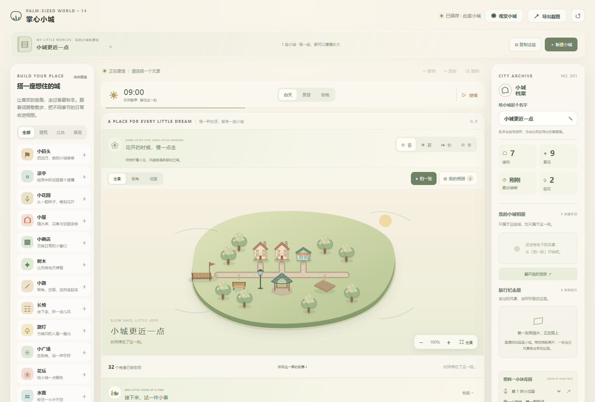

# 掌心小城

一座可以慢慢搭建的掌心小岛。没有预算、倒计时和经营压力；放下小屋，铺一条路，给邻居留个喜欢的角落。

[在线试玩](https://hgb-2005.github.io/palm-city/) · [GitHub 仓库](https://github.com/Hgb-2005/palm-city)

纯 HTML、CSS、JavaScript 与 SVG，无需安装游戏引擎或构建依赖。电脑和手机都可以打开，支持本地自动保存、多座小城、文件备份、四季居民故事和照片相册。不同网址、浏览器和设备的存档独立；从本地预览转到在线版本时，可以在收藏馆先「备份」，再到在线版「导入小城」。



当前为第十四版「小城更近一点」。

- **手机里，小城更近一点**：窄屏按实际画布比例取景，全景下整座岛屿和码头保留在画面中，岛屿比原来的宽幅取景放大约 29%；缩短多余留白，右下角镜头按钮与顶部取景按钮可触摸，最小为 44px。横竖屏变化只调整取景窗口，沿用当前缩放和平移，不额外写入设备专属存档。
- **选一个角落，靠近看看**：选中元素后，编辑栏新增「靠近」。主动点击才把镜头平缓移到这个角落，保留已经选择的更近距离；右下角「全景」随时回到整座岛。普通选中与持续布置保持当前镜头，拖动画面或开始编辑会结束尚未完成的镜头移动；「动态：静止」直接切换。镜头随当前城市保存。
- **布置，会留下小小变化**：树旁的长椅添落叶，水边添芦苇与小石头，灯下添盆栽；花园或花坛靠近小店时，窗边添上花箱。选中时可以读到变化缘由，实际道路和赴约条件仍按原规则判断。移走景物或撤销后重新生成细节，不添加隐藏物件或新存档字段。
- **每次安放，都有一点回应**：放置、接路、移动、旋转、删除、撤销和重做时，角落留下短暂的轻柔光圈；周围外观随之变化的长椅、小店和小屋也会回应。开启「动态：静止」会立即收起，所有照片和 PNG 导出会移除反馈光圈与编辑标记。
- **减少不必要的绘制**：移动在同一个吸附落点内不再重建整幅场景，预览模型只在落点或素材改变时重绘，静态布景的遮挡节点复用；居民画面没有变化时跳过重复 DOM 更新。保持原有生活、故事、花园、相册与备份格式，继续读取已有小城。
- **手机连续操作更可靠**：修复触摸按钮关闭面板后，同一次触摸的浏览器补发点击误落到下方按钮的问题；仅拦截同一根手指的补发点击，下一次触摸、鼠标与键盘继续正常工作。居民档案关闭按钮扩大至 44px。

本轮参考的是交互与设计思路，所有新增代码和 SVG 细节均在当前项目内实现：

| 参考作品 | 值得采纳的优点 | 本版的落地 |
| --- | --- | --- |
| [Townscaper](https://store.steampowered.com/app/1291340/Townscaper/) | 简单搭建，由布置自动形成有变化的景物 | 扩展已有环境外观，增加布置反馈 |
| [Tiny Glade](https://store.steampowered.com/app/2198150/Tiny_Glade/) | 建筑和装饰回应周围布置，细节自然出现 | 树荫、水边、灯下长椅与花间小店 |
| [Cytopia](https://github.com/CytopiaTeam/Cytopia) | 开源城市项目，提供镜头平移、缩放与定位 | 手机取景适配、主动靠近选中元素、一键全景 |

其中 Cytopia 为开源项目；Townscaper、Tiny Glade 为同类商业作品，参考其公开介绍中的设计思路。

## 先靠近一个喜欢的角落

1. 刷新已有页面，点选一间小屋或一张长椅，再点浮动工具栏「靠近」。点右下角「全景」返回整座岛。
2. 在长椅旁安放树木、水面或路灯，看看椅边的新细节；在小店旁添花坛或花园，看看窗边花箱。
3. 撤销、重做，观察布置与细节如何一起恢复。「动态：静止」会收起光圈和缓动。
4. 点「拍一张」留下当前取景。照片继续保存拍摄时的画面，后来改建或换设备大小不会改写旧照片。

## 前一版：从一件小事开始

- **打开先看见小城**：桌面画布提前到来客面板之前，手机的四季工具栏收为一行，把更多空间留给岛屿；320px 窄屏顶部用带文字说明的图标按钮，城名保持完整。
- **下一步，就从一件小事开始**：画布下方新增可收起的小事指引。空岛先引导小屋、商店和街道；已有邻居的小城会邀请你记下这一季的约定，再按真实缺少的布置提示花园、长椅、树木或路灯。接路先定位、展示规划，再由你点击铺下，可撤销和重做。
- **从种子走到一句谢谢**：指引可以直接播种、浇水、继续小城时间、看看晴天或冬夜，也能跟随邻居赴约。花园成长百分比、是否有真实道路、故事是否实际完成都会重新检查；下雨、暂停和等待时如实说明，所有完成仍以邻居实际到场并停留为准。已完成的季节可以转到下一个未完成的故事，四季都有回忆后可拍照留念。
- **跟着原来的城继续**：指引读取现有布局、花园和故事存档，刷新、撤销重做、切城后重新判断，不增加新的任务进度或文件格式。里程提示表示当下已存在的入住、相通街道与故事回忆；没有期限，可随时收起，观赏模式自动隐藏。

- **按住看看落点**：手机选好素材，按住画布会显示吸附网格的半透明素材、落点和手指上方的缩略预览；轻点松手即放置，拖动仍是浏览。选中元素再点「移动」，拖动时显示原位置与目标坐标，松手安放；落点越界或小路重叠时恢复原位置。双指缩放、取消手势或按 Esc 都会取消未完成的移动。
- **每一步，都能再想想**：桌面工具栏与手机底栏新增「重做」。放置、移动、旋转、复制、删除、接路、恢复初始布局与整笔拖拽铺路均支持撤销和重做，最多保留最近 24 次布置。撤销用 Ctrl / ⌘ Z，重做用 Ctrl / ⌘ Shift Z，Windows 也可用 Ctrl Y。取消或没有改变位置时保留重做；提交新布置才清除旧分支。记录属于本次编辑，刷新、切城后清空；已保存的布局继续保留。
- **小路通向哪里，看得清楚**：选中建筑后，规划路线标出「门前」和「街道」，提示还要铺几段；说明同时列出沿现有小路真正可达的住宅、商店数量。尚未铺下的规划线不算可达。一键接路后立刻重算，整次接路可以一步撤销或重做。
- **回忆继续生长**：撤销和重做只恢复布局，保留已完成故事、心愿、日记、花园成长、照片、天气、季节与镜头。编辑预览不会进入截图、随手拍或来客明信片，旧城和备份格式继续兼容。

- **你布置的角落，是邻居记得的一天**：画布下方新增四季故事本，也可以点击画布底部「听听这一季的故事」。每季一份没有期限的小约定：春日「等一朵花开」、夏日「留一片树荫」、秋日「和落叶坐一会儿」、冬日「冬夜的一点暖」。点击「陪邻居完成」，跟着清单慢慢布置；花园、树木、长椅与路灯从这里就能直接选择安放。
- **故事发生在真实的小路上**：春天要给小花园播种、浇水，等真正开花；夏秋要把长椅放在树旁，冬天要有附近路灯并等到夜晚。每个故事都检查居民家到设施的道路。邻居沿路走到那里、停留一会儿后才完成；春日站着看花，冬夜坐下喝茶，并说一句感谢。原有已回应的心愿优先完成，故事随后继续；居民与游客继续共用原有的长椅占用规则。
- **一城四页，慢慢珍藏**：完成后写入小城日记，可下载此刻小城与故事组成的 PNG 纪念卡。每座城的每季故事只完成一次，刷新、撤销和来回换季不会重复记录；日记超过 100 篇后较早的一页可能移出列表，故事本依然保留完成进度。未完的故事换季后等候，切回来继续；下雨先避雨，断路、搬走目标、移除树木或路灯时重新等待布置，恢复后再出发。
- **带着故事继续原来的小城**：沿用第七版城市与文件备份格式，旧存档无需重新开始。约定和完成状态随当前城市保存，也跟随复制、切城和文件备份往返；没有离线推进。390px 与 320px 手机支持触摸回应和切季节，春日故事提供直达花园的入口。

- **同一座城，四种季节**：画布上方点击「春 / 夏 / 秋 / 冬」随时切换，不用等待现实日期。春日树梢开小花，夏日树叶浓绿，秋日树下散落金黄叶片，冬日地面、树梢和屋檐覆上薄雪；土地与天空也有各自的色调。季节由你选择，不会自动轮换。
- **跟着四季散步**：夏天邻居戴草帽，冬天戴针织帽、围上围巾，闲聊会提到花、树荫、落叶和热茶。招手、购物、心愿、避雨时优先保留正在发生的对话。切换季节后，邻居沿原路继续走，花园照料和成长规则保持原样；冬天依然可以种花，晴雨控制继续可用。
- **照片记得当时的季节**：新随手拍和来客明信片记录拍摄季节。换季、改名和改建后，历史照片保持原画面与原标注；旧照片没有记录的季节不补写。PNG 下载、相册留言与小城文件备份一并保留这些回忆。
- **每座城，都有自己的四季**：刷新、复制、切城和导入备份会保留各自选择的季节。旧城直接继续使用，初次进入显示春日；建筑布局、居民身份、心愿、日记、花园、来客与已有照片继续保留。手机支持触摸切换，开启「动态：静止」后颜色直接切换。

- **跟着邻居走走**：点击居民，或在居民列表打开档案，选择「跟着走走」。进入观赏模式后，镜头平缓跟随这位居民；回家时镜头停在他的家。拖动画面、双指缩放、手动缩放或点击「停在这里」即可结束跟随，保留当前视角。Esc 先结束跟随，再按一次返回建造。「动态：静止」会直接切换镜头，避免缓动。
- **三种取景距离**：画布上方提供「全景 / 街角 / 邻居」。全景回到整座小岛；街角与邻居优先对准选中的居民或建筑。自由缩放范围扩大到 72%–360%，手机双指同样可用。视角会保存，刷新后保持停下的位置，跟随状态不会自动恢复。
- **只属于自己的随手拍**：点击「拍一张」，冻结当前镜头里的画面，写最多 80 字留言后「收进相册」。关闭预览会舍弃未保存的草稿。每座小城最多珍藏 20 张，满了会提示整理，不会自动移除旧照片。照片记录拍摄时的城名、晴雨、小城时间与同行邻居，改建、改名、切天气后仍保留原貌。
- **相册与照片下载**：画布上的「我的相册」和档案侧栏均可翻看。可以修改留言、移出照片并撤销，也可以下载附留言的 PNG。压缩画面最长边不超过 1200 像素；相册随当前城市刷新、切换、复制、备份和导入一起保存。它与游客留下的旅行纪念册分别收藏。

- **自然连接的街巷**：小路随相邻道路生成圆润转角、三岔和十字路口。选中小屋、商店、长椅、广场、凉亭、花园或码头后，若尚未接入主要街道，会出现浅绿色规划线；点击画布工具栏的「接路」可一次铺下，撤销一次即可全部恢复。新路避开建筑、水面、树干等已有素材，优先少铺路；已有的独立支路会尝试接到最大的路网。没有小路时先手动铺一段；入口被堵住时挪开一些素材再试。
- **五种会回应环境的屋檐**：小屋靠近水面会出现蓝灰屋顶、露台和救生圈；靠近花园或花坛会添上藤蔓与窗台花；相邻住宅形成带二层窗户的邻里小楼；靠近树木则变成林间小屋，独立空地上是暖阳小屋。同处多种环境时，依次优先水岸、花园、邻里和林间。外观由周围布置决定，移动、删除或撤销后会自动重算；房屋编号、居民身份和心愿保持原样。选中小屋可读到外观说明，收藏馆缩略图也会对应变化。
- **路上的一声你好**：两位居民走到同一段真实道路附近时，会短暂停步、招手和问好，再继续原来的行程；同一对邻居不会不停重复招呼。下雨会立即继续原有避雨行为。坐到长椅后会翻书或喝茶，从商店回来会提着购物袋，行走时有迈步和朝向变化。暂停同时停下这些动作，「动态：静止」收起摆臂和迈步，但保留可读的静态姿势。
- **继续原来的小城**：本次沿用第七版收藏馆与备份格式，直接读取已有存档，无需重新导入。手机上画布优先显示在来客面板之前，新增「接路」也支持触摸。

- **多座小城，各自珍藏**：顶部打开「我的小城收藏馆」，可以新建、命名、复制和切换小城。每座城独立保存建筑、居民身份、心愿、日记、天气、花园成长、游客行程与旅行纪念册。切换前会先保存当前城市；暂时离开的城市不计算时间与离线成长。
- **保留原城再改建**：点击「复制这座」，给副本起个名字，再放心调整布局。原城与副本互不影响；复制会带上已经积累的花园、心愿、日记和明信片，随后各自继续。重命名不会改动历史明信片上的旧名字。
- **四种主题开局**：林间村落、滨水小镇、花园街区，以及一座空岛。前三种主题预先接好住宅、商店、码头、花园、树下长椅和凉亭之间的小路；所有素材都可以移动、删除和继续建造。空岛从零开始。
- **小城文件备份**：在收藏馆卡片上点击「备份」，下载 JSON 文件；通过「导入小城」恢复完整进度，默认创建新副本，同名会自动加序号。文件可交给朋友继续建造。单个文件上限 16 MB，无法识别或损坏的文件会提示原因，原有城市保持原样。
- **手机建造**：侧栏默认收起，通过底部「建造」选择素材，轻点画布放置。拖动用于浏览，不会误放建筑；轻点选中元素，再点「移动」拖动它，支持撤销。双指可以缩放和移动视角；开始双指操作时会取消尚未完成的元素移动。底部「档案」照料花园和翻看日记，「收藏馆」切换城市。
- **升级与多窗口**：首次打开会将第二至第六版的原城完整收进收藏馆，原存档保留。城市数据存入当前浏览器的本地数据库；其他浏览器和设备通过文件备份交换。多个页面同时修改同一座城时会提示冲突，可将本页改动保留为新副本，或重新载入另一页的存档。

- **乘船来访**：新增可建造、移动、复制和撤销的小码头。入口接上小路后，点击「邀请来客」，花草旅人阿远乘船到访；离开后可以立即再次邀请，没有现实日期限制。
- **一位游客的一日游**：阿远沿实际路网选择可到达的花园，赏花、为开花的花园拍照，再到树旁约两格范围内的长椅休息，最后沿路回码头。气泡和来客面板会显示他的感想；没有接通的景点会略过，明信片如实记录实际到访的地方。
- **晴雨间的行程**：下雨会撑伞，沿路寻找凉亭避雨；没有可达凉亭时原地撑伞等雨停。放晴后继续未完成的行程。暂停会同时停下游客与小船，刷新会恢复这次来访，不计算离线时间。
- **改建也能继续游览**：拆路、移动和删除设施后重新寻路；中断的停留不会误记成已完成。附近道路完全断开或回程码头缺失时，游客停下等候，接好道路、补回码头后继续。也可以点击「结束本次来访」，不会生成未完成旅程的纪念卡。一张长椅不会同时分配给居民和游客。
- **旅行纪念册**：返回码头时留下一张「第一次来访」明信片，后续标注来访次数。记录当时的小城名字、天气、时间、景色和感想，保存最近 24 张。点击卡片可以预览并保存 PNG；改名、改建、撤销、切换天气或刷新后，旧明信片保留原来的画面。为节省浏览器空间，历史画面以压缩图片保存，导出通常为 1000 × 600 PNG。

- **晴天与小雨**：可以手动切换，也会按约 90 秒晴天、45 秒小雨自动轮换。「暂停天气」只暂停自动轮换，保持当前天气；顶部「暂停」会同时暂停小城时间、居民、天气进度和花园成长。
- **邻居会避雨**：已经出门的居民撑起伞，沿已有道路去可到达的附近凉亭；没有合适凉亭就沿路回家。在家的人会留在屋内听雨。雨停后，避雨的居民先回家收伞，再恢复散步与心愿。
- **能照料的小花园**：新增「小花园」素材；原有花坛仍是装饰。选一块花园，在右侧点击「播下种子」，再浇水或等雨。成长经过种子、嫩芽、花苞、开花；水分充足时约 40 秒长成，小雨期间花苞会等到雨停后再绽放。
- **雨后开花的日记**：经历过雨水浇灌的花园第一次开花，会记录「小城的第一次雨后开花」，不会因刷新、切天气或撤销而重复。手动照料的花园也会留下开花日记，都可以保存纪念卡。
- **安静的雨夜**：雨天光线、水面涟漪、屋檐滴水与暖色窗光会随昼夜变化。雨声默认关闭，可独立开启；刷新后点击「续听」恢复声音。「动态：静止」会收起大部分雨线，停下雨滴与涟漪动画，也会默认尊重系统减少动态的设置。
- **慢慢长大，随时回来**：花园阶段和水分会保存，不计算离线时间，不会枯萎。移动、旋转和删除后撤销会保留这块花园的成长；复制得到一块新土地。撤销只恢复布置，花园照料与已经发生的日记继续保留。

- **三种小心愿**：同时展示最多 3 位居民的心愿，点击卡片查看，再选择回应。心愿没有期限；清单会提示还缺哪些布置。
- **树下的长椅**：放置长椅，让树木在它约两格范围内，再把家门口的小路连到长椅旁。邻居会沿路走来，坐下休息、说一句感谢，随后完成心愿。
- **街角见个面**：给小广场接通两位邻居的家。他们会走到同一座广场，等彼此到齐后停下聊天。
- **晚归的灯**：给长椅旁添一盏路灯，接通道路，再等夜晚或手动切换夜晚。灯光会照亮街道，邻居走到长椅休息后完成心愿。
- **小城日记**：记录首次休息、广场会面和夜间休憩；同一个生活片刻不会反复写入。保存最近 100 个片刻，可以展开阅读。
- **纪念卡**：点击日记中的「保存纪念卡」，预览当前小城与这篇日记组成的卡片，再点击「保存 PNG」下载。截图与纪念卡均为 1600 × 960。
- **居民生活**：每间小屋入住一位居民，最多 5 位。居民沿路购物、休息和回家；一张长椅同一时刻只坐一人。拆路、移动或删除设施后会重新规划，失去条件的心愿不会误完成。
- **小城时间**：昼夜自动变化，夜晚窗口与路灯亮起。小城的 1 天约为现实 6 分钟。「暂停」同时暂停居民与时间；布置完后记得点击「继续」。
- **自由建造**：小屋、商店、树木、小路、长椅、路灯、小广场、凉亭、小花园、小码头、花坛和水面。直接拖动可移动，选中后可旋转、复制、删除和撤销；拖拽铺路可一次撤销整笔。
- **自动保存**：每次编辑后保存当前小城，并定期记录生活进度；刷新和切换会保留城市、名字、视角、时段、天气、暂停、花园、居民身份、心愿、日记、游客和纪念册。旧城市可自行添加码头、凉亭和小花园。刷新后居民从家中重新开始，游客继续自己的来访。
- **观赏模式**：收起建造面板与心愿卡，安静看看小城。可切换时段、查看居民和拍照，按 Esc 返回建造。

## 打开小城

双击 `启动小城.cmd`，保留服务窗口，再访问 `http://127.0.0.1:4173/`。服务窗口关闭或电脑重启后，需要再次运行启动文件。

也可以在当前目录运行：

```powershell
python -m http.server 4173 --bind 127.0.0.1
```

已有页面请刷新一次。存档保存在当前浏览器中，其他浏览器不共享。

## 先试一件小事

1. 打开或刷新小城，看看画布下方「接下来，试一件小事」。空岛从小屋开始，原有小城会直接接着当前布置提示。
2. 点击指引按钮选择素材，再在画布上安放。遇到接路提示，第一次点击查看入口和规划，第二次点击明确的段数才会铺路。
3. 记下约定后，跟着提示播种、浇水、接路。准备好了就继续小城时间，等邻居真正走来；也可以点击「跟着邻居走走」。
4. 有了这一季的回忆，可以去听另一季的故事。指引可收起，随时回到自由建造。

## 也可以先陪邻居写一页小故事

1. 刷新已有页面，点击画布底部「听听这一季的故事」，在故事本中点击「陪邻居完成」。四个季节标签也可以直接切换小城的季节。
2. 春日先「安放小花园」，或直接「去照料花园」，播种、浇水并等花开；夏秋在树旁安放长椅；冬日给长椅旁添路灯，再点击「看看夜晚」。清单会逐项提示。
3. 把家门口的小路连到设施旁。小城若暂停，点击顶部「继续」。邻居完成手边已回应的心愿后，会沿路赴约；等他在那里停留一会儿。
4. 邻居说出感谢，故事本标记「已珍藏」，日记添上一页。点「保存这一页」预览并下载纪念卡。未完成也没关系，切到其他季节再回来，约定还在。

## 也让同一个街角走过四季

1. 刷新已有页面，在画布上方点击「春 / 夏 / 秋 / 冬」，看看树梢、屋檐和地面的变化。
2. 点击一位邻居，选择「跟着走走」。在夏日看看草帽，冬日看看围巾；若小城暂停，点击「继续」让邻居出门。
3. 停在喜欢的街角，点「拍一张」写句留言。换一个季节，再为同一处风景留张照片。
4. 「我的相册」会记住每张照片当时的季节。收藏馆的「备份」可带走整座小城与相册。

## 也可以去散步，再留下这一刻

1. 刷新已有页面，点击一位邻居，选择「跟着走走」。时间暂停时，可以点击「继续」看他沿路出门。
2. 到了喜欢的街角，轻轻拖动画面停下来，或用「全景 / 街角 / 邻居」调整取景。
3. 点击「拍一张」，写一句话，再点「收进相册」。点「我的相册」随时翻看或下载 PNG。
4. 想保留整座小城和相册，在收藏馆里导出「备份」。存档保存在当前浏览器中，文件备份可以带到其他浏览器和设备。

## 也让街巷长出一点变化

1. 刷新已有页面，先点「复制这座」，在副本里尝试改建。
2. 放下一间离街道稍远的小屋，选中它，看看浅绿色接路规划；点击浮动工具栏「接路」。一次撤销可以恢复整条新增道路。
3. 在小屋附近添一片水面，或添上花坛、树木和另一间小屋，观察屋顶、门廊和窗台的变化。选中房屋可以读到当前外观的缘由。
4. 点击「继续」，让邻居出门。等他们在路上相遇，会停步招手；坐到树下长椅后，会读书或喝茶。

## 也可以收藏另一座小城

1. 刷新页面，在顶部点击「复制这座」，为副本命名并开始改建。原来的城市会完整保留。
2. 打开「我的小城收藏馆」，在两座城市之间点击「继续建造」，各自的心愿、花园、日记和明信片都在原处。
3. 点击「新建小城」，选一种主题或空岛。新开局拥有独立的生活进度。
4. 在卡片上点击「备份」，再通过「导入小城」选择该 JSON 文件，可以得到一座新的完整副本。

## 再邀请一位来客

1. 新城市已有码头、花园和树下长椅；直接点击「邀请来客」。旧城市从素材栏放下「小码头」，入口与小路对齐、留约一格，再连到城里的道路。来客面板会提示还缺什么。
2. 阿远乘船靠岸、沿路去花园。要看到拍照，可先播种并浇水，等约 40 秒花开后再邀请。
3. 游览中切一次「小雨」，看看撑伞和避雨；再切「晴天」，让旅程继续。
4. 等阿远回码头，右侧「旅行纪念册」就会收到一张明信片。点击预览、保存 PNG，或者再邀请一次。

## 也可以先听一场小雨

1. 在右侧「照料一小块花园」点击「播下种子」。旧城市先从左侧放一块「小花园」，也可以给道路旁约一格的位置添座「凉亭」。
2. 先让小城运行几秒，等邻居出门，再切到「小雨」。邻居会撑伞走向附近可到达的凉亭，花园开始喝雨水。
3. 等种子长成花苞，再切回「晴天」；也可以等 45 秒后自动放晴。花会继续缓缓绽放，日记记下第一次雨后开花。
4. 在日记中点击「保存纪念卡」，预览后保存 PNG。再试试「夜晚 + 小雨」，或开启独立雨声。

如果花园还没有足够成长，雨停后会继续缓缓长大。要留住雨天，可以点击「暂停天气」；要暂停所有生活与成长，用最上方的「暂停」。

## 也可以回应一个小心愿

1. 点击「小林的心愿 · 树下的长椅」，选择「帮小林实现」。
2. 点击清单下方的素材按钮，在已有小路旁约一格的位置放长椅，再在长椅约两格内添一棵树。
3. 清单全部打勾后，保持时间运行，等小林走来坐下。
4. 在右侧日记中保存这一页纪念卡。

道路按 48 单位网格连接，只连接上下左右。设施入口应在道路旁约一格，避免隔着斜角；心愿清单会检查从家到设施的完整通路。地图下方坐标可辅助摆放。

## 验证

纯逻辑测试需要 Node.js 22 或更新版本，无需安装依赖。在项目根目录运行 `node --test` 即可，也可以明确指定测试文件：

```powershell
node --test tests/city-guide.test.cjs tests/city-building.test.cjs tests/city-life.test.cjs tests/city-weather.test.cjs tests/city-visitors.test.cjs tests/city-collection.test.cjs tests/city-design.test.cjs tests/city-roaming.test.cjs tests/city-seasons.test.cjs tests/city-stories.test.cjs
```

覆盖居民往返、断路与旁路、心愿实际使用、两人会面、夜间心愿、存档身份；以及天气轮换、雨水和手动浇水、成长阶段、雨后开花去重、离线恢复、花园移动/删除/复制、撑伞避雨、雨停恢复、天气中断心愿和夜晚切换。

游客测试还覆盖完整一日游、重复邀请、真实路段、避雨续游、拆路与旁路、删除和移动景点、码头替换、座位占用、行程保存恢复和明信片事件去重。收藏馆测试覆盖各主题的真实路网、空岛开局、深复制隔离、完整备份往返、名字冲突、旧文件迁移、无效文件与不安全画面拒绝。第八版新增街道路口、真实可达的自动接路、绕行障碍物、支路接通、无法规划、房屋环境变化、存档不变、招手后续行、招手遇雨以及实际到访后读书、喝茶和提袋。共 62 项纯逻辑测试。

第九版新增镜头取景、平滑跟随、帧率一致性、室内回家、照片元数据、旧城兼容、相册复制和备份往返，以及损坏图片、超量与重复照片的验证，共 70 项纯逻辑测试。

第十版新增四季颜色、昼夜光线保留、确定的季节装饰、居民服饰与对话、季节照片与旧照兼容、无效季节拒绝、备份往返以及行程保留，共 78 项纯逻辑测试。

第十一版新增 13 项，覆盖四季故事的回应、真实到访与停留、春日开花和冬日夜晚条件、下雨等待、断路和目标改建、换季续约、长椅占用、原有心愿优先、完成后感谢与回家、刷新与居民变化、独立复制及备份兼容，以及无效故事记录拒绝。共 91 项纯逻辑测试。

第十二版新增 10 项，覆盖多步撤销重做、分支更新、无效操作与取消后保留重做、移动回原位、手势中的保存、快照隔离与 24 步限制、切城清空、网格吸附与铺路补齐，以及实际路网可达数量，共 101 项纯逻辑测试。

第十三版新增 13 项，覆盖空岛循序引导、接路先预览后铺下、孤立支路与被挡入口、明确回应故事、播种浇水与生长等待、失效花园记录、夏秋树荫、冬日灯光与夜晚、雨天和暂停、真实赴约后才完成、下一季及四季相册提示，以及旧备份不变，共 114 项纯逻辑测试。

第十四版新增手机取景比例与岛屿边界、树荫与水岸长椅、花间小店，以及布置差异和撤销反馈验证，共 118 项纯逻辑测试。

开发期间的浏览器验证使用独立上下文，保护用户现有存档。第十四版已检查镜头保存、取景与照片一致、DOM 重绘次数、环境细节、减少动态设置，以及 390px、320px 手机的触摸、跟随、双指缩放、横竖屏切换、撤销重做和切城。第十二、十三版建造和故事流程也已回归。生成的验证记录、备份和临时截图保留在本地 `artifacts/`，不进入仓库；仓库中的示例截图位于 `docs/images/`。
